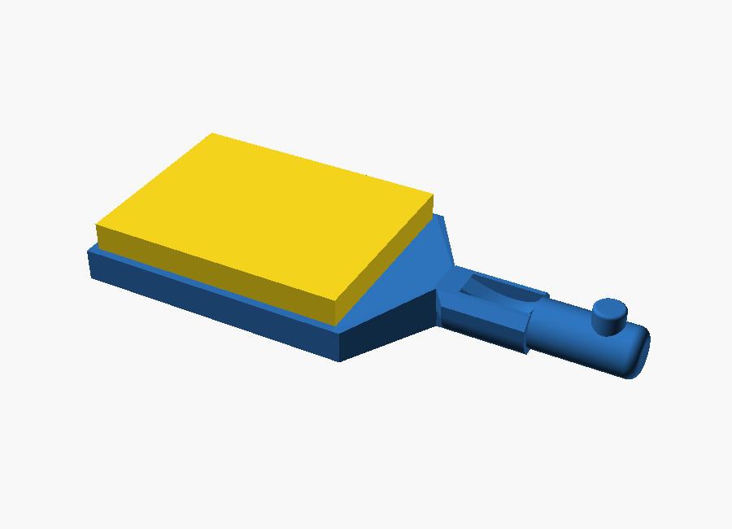

# NeoSander Sponge Head

**A 3D-printed head that lets the HOZO NeoSander use ordinary wet-and-dry sanding sponges, plus a jig that cuts
the sponges to size.**



HOZO's own heads take small, purpose-made sanding pads. Hobby sanding sponges, like Stedi's 5 mm strips, are
cheap, come in a wide range of grits and work wet. This head takes a piece of one of those instead.

- **Fits like a HOZO head.** The plug is HOZO's own geometry from their open-source flat head, unchanged, so it
  clicks into the tool the same way.
- **Tool-free sponge swaps.** The sponge press-fits into a shallow pocket and pushes out through a hole in the back.
- **Prints flat, no supports.** Same orientation as HOZO's heads. About 1.7 g, close to HOZO's own 1.2 g paddle,
  so the motor isn't overloaded.
- **Square, repeatable pieces.** A printed mitre-box jig cuts every piece to exactly 26 mm, three per strip.
- **Parametric.** OpenSCAD, with every dimension at the top of the file.

## Using it

### Cut the sponge

Cut the 80 × 20 × 5 mm strip into 26 mm pieces with the jig and a snap-off knife.


Extend the blade far enough to reach the floor of the jig: about two segments of an 18 mm snap-off knife. Use an
old blade if you have one, because the grit blunts it.

### Fit the sponge and sand


Then push the head into the NeoSander like any HOZO head. The sanding face is on the same side as the plug's peg.

The sponges work wet, but keep water off the NeoSander: use a damp sponge, not a dripping one.

## Squeeze test variants

How tightly the pocket should grip the foam is still being tuned. Too loose and the sponge walks out under
vibration; too tight and the foam bulges. There are four versions, each with its value engraved on the back:

| Engraved | Pocket (mm) | Squeeze per side | File |
|---|---|---|---|
| `0`   | 26.0 × 20.0 | none (use tape) | `stl/sponge_head_26_fit0.stl` |
| `0.2` | 25.8 × 19.8 | 0.1 mm | `stl/sponge_head_26_fit0.2.stl` |
| `0.4` | 25.6 × 19.6 | 0.2 mm | `stl/sponge_head_26_fit0.4.stl` |
| `0.6` | 25.4 × 19.4 | 0.3 mm | `stl/sponge_head_26_fit0.6.stl` |

If none of them holds well enough, a square of thin double-sided tape on the pocket floor will.

## Printing

`print/neosander_test_plate.3mf` has the jig and all four heads on one plate, laid out as they print.


| | |
|---|---|
| Material | PETG (Bambu PETG HF on an X1C) |
| Layers | 0.16 mm, for the engraved text and the plug's latch |
| Walls | Slicer default (2). HOZO prints most of its own heads this way |
| Plate | Textured PEI |
| Supports | None. The jig's guide block is a 20 mm bridge. |
| Time / weight | 44 min, 14 g for the full plate |

## Making changes

| File | What |
|---|---|
| `sponge_head.scad` | The head: `pad_len`, `fit`, pocket depth, walls, push hole, label |
| `cut_jig.scad` | The cutting jig. `piece_len` should match the head's `pad_len` |
| `print/plate.scad` | The print plate layout |
| `renders/render.sh` | Regenerates every image in this README from the STLs (needs OpenSCAD and Pillow) |
| `hozo/3mf_to_stl.py` | Extracts a head mesh from HOZO's 3MF |

```bash
openscad -o stl/sponge_head_26_fit0.4.stl -D pad_len=26 -D fit=0.4 sponge_head.scad
openscad -o stl/cut_jig_26.stl cut_jig.scad
openscad -O export-3mf/color-mode=none -o print/neosander_test_plate.3mf print/plate.scad
./renders/render.sh
```

Rebuilding the head needs HOZO's mesh, which isn't in this repo. Download the
[Flat Sanding Head ×5](https://makerworld.com/en/models/2802755-hozo-neosander-flat-sanding-head-x5) 3MF from
MakerWorld, unzip it, and run
`python3 hozo/3mf_to_stl.py <unzipped>/3D/Objects/object_3.model hozo/hozo_flat_head_3.stl`. The STLs in `stl/`
are ready to print without it.

The pad length is a parameter. `pad_len=40` gives two pieces per strip and a 2.2 g head, if 26 mm feels too small.

## Status

Designed, not yet printed (2026-11-24). Still to confirm: that the plug clicks into a real NeoSander, which
squeeze variant holds best, and how cleanly the jig cuts.

## Credits

The plug is HOZO's design, from their open-source
[NeoSander Flat Sanding Head ×5](https://makerworld.com/en/models/2802755-hozo-neosander-flat-sanding-head-x5).
HOZO's original files aren't redistributed here.
