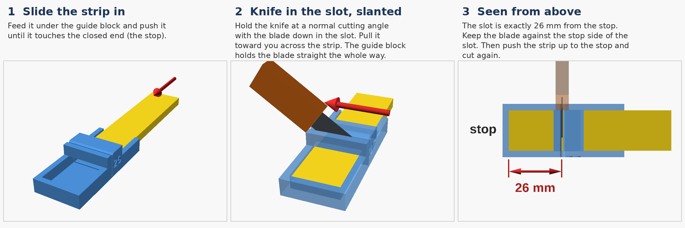
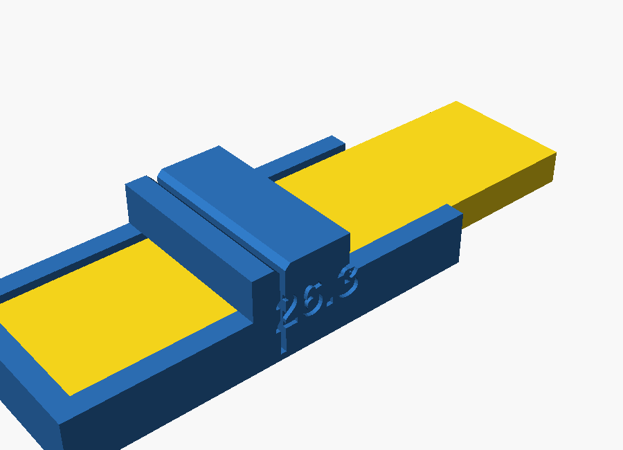
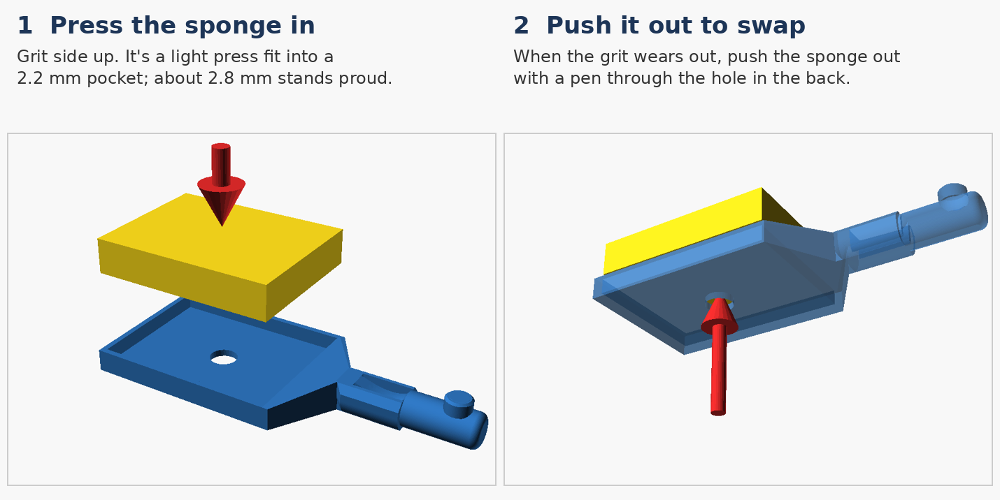
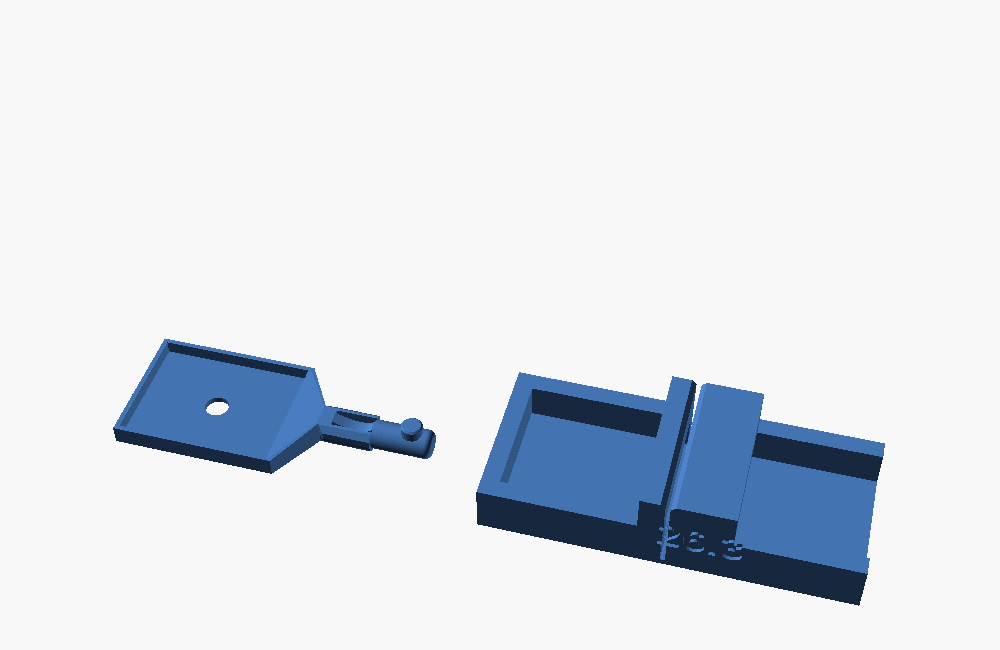

# NeoSander Sponge Head

**A 3D-printed head that lets the HOZO NeoSander use ordinary wet-and-dry sanding sponges, plus a jig that cuts
the sponges to size.**


HOZO's own heads take small, purpose-made sanding pads. Hobby sanding sponges, like Stedi's 5 mm strips, are
cheap, come in a wide range of grits and work wet. This head takes a piece of one of those instead.

- **Fits like a HOZO head.** The plug is HOZO's own geometry from their open-source flat head, unchanged, so it
  clicks into the tool the same way.
- **Tool-free sponge swaps.** The sponge press-fits into a shallow pocket and pushes out through a hole in the back.
- **Prints flat, no supports.** Same orientation as HOZO's heads. About 1.7 g, close to HOZO's own 1.2 g paddle,
  so the motor isn't overloaded.
- **Square, repeatable pieces.** A printed mitre-box jig cuts the strip into three equal 26.3 mm pieces with nothing wasted.
- **Parametric.** OpenSCAD, with every dimension at the top of the file.

## Using it

### Cut the sponge

Cut the 80 × 20 × 5 mm strip into three equal 26.3 mm pieces with the jig and a snap-off knife.





Extend the blade far enough to reach the floor of the jig: about two segments of an 18 mm snap-off knife. Use an
old blade if you have one, because the grit blunts it.

### Fit the sponge and sand



Then push the head into the NeoSander like any HOZO head. The sanding face is on the same side as the plug's peg.

The sponges work wet, but keep water off the NeoSander: use a damp sponge, not a dripping one.

## Printing

`print/neosander_plate.3mf` has the jig and the head on one plate, laid out as they print.



| | |
|---|---|
| Material | PETG (Bambu PETG HF on an X1C) |
| Layers | 0.16 mm, for the plug's latch |
| Walls | Slicer default (2). HOZO prints most of its own heads this way |
| Plate | Textured PEI |
| Supports | None. The jig's guide block is a 20 mm bridge. |

The pocket is 0.2 mm undersize (25.8 × 19.8 mm), so the foam is squeezed 0.1 mm per side. That held the sponge
well in testing; a bigger squeeze made the foam bulge. The locking peg on the plug is 0.6 mm wider than HOZO's
(3.6 mm instead of 3.0) because HOZO's size rocked loose in the tool.

## Making changes

| File | What |
|---|---|
| `sponge_head.scad` | The head: `pad_len`, `fit`, `peg_grow`, pocket depth, walls, push hole |
| `cut_jig.scad` | The cutting jig. `piece_len` is (strip length - 2 × kerf) / 3 |
| `print/plate.scad` | The print plate layout |
| `renders/render.sh` | Regenerates every image in this README from the STLs (needs OpenSCAD and Pillow) |
| `hozo/3mf_to_stl.py` | Extracts a head mesh from HOZO's 3MF |

```bash
openscad -o stl/sponge_head.stl sponge_head.scad
openscad -o stl/cut_jig.stl cut_jig.scad
openscad -O export-3mf/color-mode=none -o print/neosander_plate.3mf print/plate.scad
./renders/render.sh
```

Rebuilding the head needs HOZO's mesh, which isn't in this repo. Download the
[Flat Sanding Head ×5](https://makerworld.com/en/models/2802755-hozo-neosander-flat-sanding-head-x5) 3MF from
MakerWorld, unzip it, and run
`python3 hozo/3mf_to_stl.py <unzipped>/3D/Objects/object_3.model hozo/hozo_flat_head_3.stl`. The STLs in `stl/`
are ready to print without it.

## Status

Done (2026-11-24). The first prints fit the NeoSander and hold the sponge, and the jig cuts cleanly. The final
version has the wider locking peg and the equal-thirds jig, sliced and ready to print.

## Credits

The plug is HOZO's design, from their open-source
[NeoSander Flat Sanding Head ×5](https://makerworld.com/en/models/2802755-hozo-neosander-flat-sanding-head-x5).
HOZO's original files aren't redistributed here.
